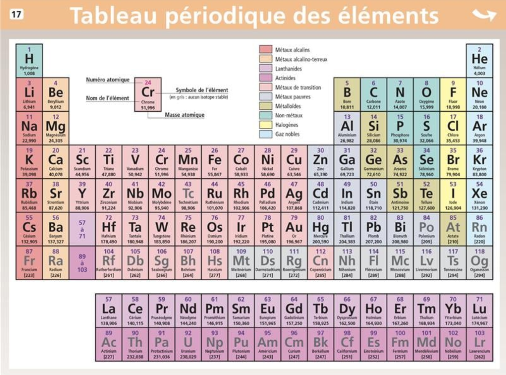

# 🔬 Sciences & Arts CM2 — Les Matériaux & le Projet Gustave Eiffel

---

## 🧪 1. Les Matériaux qui nous entourent *(L'Esprit Sorcier)*

Tout ce qui nous entoure est fabriqué à partir de matériaux choisis pour leurs **propriétés physiques** :

| Famille de matériaux | Exemples | Propriétés principales | Utilisations |
|---|---|---|---|
| **Les Métaux** | Fer, cuivre, aluminium, or | Très solides, bons conducteurs d'électricité et de chaleur | Fils électriques, structures, ponts, canettes |
| **Les Matières Organiques** | Bois, cuir, laine, coton, papier | Issus d'êtres vivants (végétaux ou animaux), isolants | Meubles, vêtements, livres |
| **Les Plastiques** | PVC, polyéthylène, nylon | Légers, faciles à mouler, isolants électriques et thermiques | Bouteilles, jouets, stylos |
| **Les Céramiques & Verres** | Porcelaine, verre, brique | Très durs, résistants à la chaleur mais cassants | Vaisselle, vitres, construction |

---

## 🗼 2. Gustave Eiffel & la Tour de 300 Mètres

- **L'occasion :** Construite pour l'**Exposition Universelle de Paris en 1889**, qui célébrait le centenaire de la Révolution française (1789).
- **Le défi technique :**
  - Mesurant à l'origine 312 mètres (aujourd'hui 330 m avec les antennes), elle a été le plus haut monument du monde pendant plus de 40 ans !
  - Construite en **fer puddlé** (un fer purifié dans des fours pour le rendre résistant et élastique face au vent).
  - Composée de plus de **18 000 pièces de fer** assemblées par **2,5 millions de rivets** !
- **Autre chef-d'œuvre d'Eiffel :**
  - Gustave Eiffel a aussi conçu la structure métallique intérieure de la **Statue de la Liberté** à New York !

---

## ⚛️ 3. Le Tableau Périodique des Éléments Chimiques

Le tableau périodique regroupe l'ensemble des **briques élémentaires de l'Univers** (les atomes) à partir desquelles toute la matière et tous nos matériaux sont formés :

### 💡 À retenir pour le CM2 :
- **Qu'est-ce qu'un élément ?** C'est une substance pure faite d'un seul type d'atome (ex: le fer `Fe`, le cuivre `Cu`, l'oxygène `O`, le carbone `C`, l'or `Au`).
- **Les grandes familles :**
  - **Les métaux** (en rouge, orange, violet et bleu clair) : très nombreux dans le tableau, conducteurs et solides.
  - **Les non-métaux et gaz** (en vert et jaune) : indispensables à la vie (Carbone `C`, Oxygène `O`, Azote `N`, Hydrogène `H`) et les gaz nobles (Hélium `He`, Néon `Ne`).
- **Le lien avec nos leçons :** Le fer de la Tour Eiffel (`Fe`), les fils électriques en cuivre (`Cu`), les canettes en aluminium (`Al`) ou l'oxygène que nous respirons (`O`) viennent tous de ce tableau universel !

