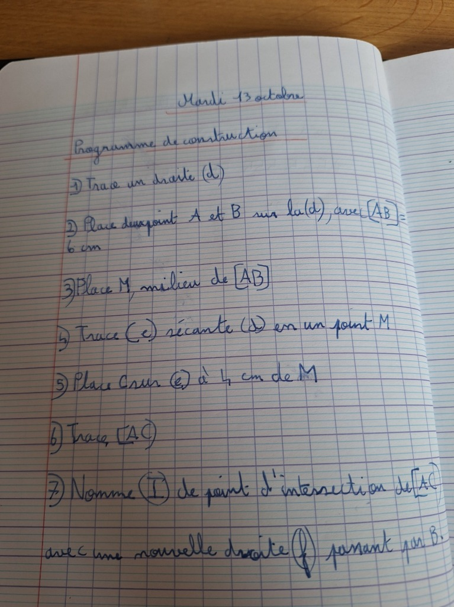

# 📐 Mathématiques CM2 : Droites, Segments, Demi-droites & Sécantes

---

## 🎯 1. Les Notions Clés et Leurs Notations Officielles

En géométrie, les notations entre **parenthèses `( )`**, **crochets `[ ]`** ou **sans rien** ont un sens mathématique très strict qu'il ne faut jamais mélanger !

| Notion Géométrique | Définition & Caractéristiques | Notation Officielle | Exemple de Tracé / Mesure |
| :--- | :--- | :---: | :--- |
| **La Droite** | Une ligne droite **illimitée des deux côtés** (infinie). Elle ne s'arrête jamais : on ne peut **jamais** la mesurer ! | **`(d)`** ou **`(AB)`** *(parenthèses)* | Tracée à la règle en prolongeant des deux côtés de la feuille. |
| **Le Segment** | Une portion de droite délimitée par **deux extrémités fixes** $A$ et $B$. Il a un début et une fin. | **`[AB]`** *(crochets)* | Le segment commence exactement en $A$ et s'arrête en $B$. |
| **La Longueur d'un segment** | La distance réelle mesurée à la règle graduée entre les deux extrémités. | **`AB = 6 cm`** *(SANS crochets !)* | On écrit $AB = 6\text{ cm}$ ou $AB = 45\text{ mm}$. *(Ne jamais écrire $[AB] = 6\text{ cm}$)* |
| **La Demi-droite** | Une portion de droite limitée d'un côté par son **origine** (fermée) et **infinie** de l'autre côté. | **`[Ax)`** ou **`[AB)`** *(crochet à l'origine, parenthèse à l'infini)* | Part de $A$ et continue vers l'infini en passant par $B$ ou vers la direction $x$. |
| **Le Milieu d'un segment** | Le point $M$ situé **sur le segment** $[AB]$ à égale distance des deux extrémités ($AM = MB$). | **`M milieu de [AB]`** | $AM = MB = \frac{AB}{2}$. On trace le même codage (double trait `//`) sur chaque moitié. |
| **Droites Sécantes** | Deux droites qui se coupent en **un seul et unique point**, appelé le **point d'intersection**. | **`(e) sécante à (d) en M`** | Le point commun $M$ appartient aux deux droites à la fois : $(e) \cap (d) = \{M\}$. |

---

## ✏️ 2. Règles d'Usage & Soin du Tracé en CM2

1. **La Mine du Crayon :**
   - Utilise un crayon à papier bien taillé (mine sèche 2H ou HB fine). Un trait trop épais fausse la mesure de presque 1 millimètre !
2. **Le Repérage d'un Point :**
   - Un point se repère **toujours par une petite croix nette $\times$** (l'intersection de deux petits traits fins).
   - On ne fait jamais un gros point colorié au feutre.
3. **Le Nom d'un Point :**
   - On nomme toujours les points avec une **lettre majuscule d'imprimerie** ($A, B, C, M, I...$), écrite proprement à côté de la croix sans toucher le trait.
4. **La Règle Plate :**
   - Place fermement tes doigts au centre de la règle pour qu'elle ne glisse pas pendant le tracé du crayon.
   - Pour mesurer, aligne le **zéro (0)** de la règle sur le premier point, et non le bord en plastique de la règle !

---

## 📖 3. Cahier de Classe du 13 Octobre : Programme de Construction

### Énoncé du Programme :
1. **Trace une droite $(d)$**
2. **Place deux points $A$ et $B$ sur $(d)$, avec $[AB] = 6\text{ cm}$**
3. **Place $M$, milieu de $[AB]$**
4. **Trace $(e)$ sécante à $(d)$ en un point $M$**
5. **Place $C$ sur $(e)$ à $4\text{ cm}$ de $M$**
6. **Trace $[AC]$**
7. **Nomme $(I)$ le point d'intersection de $[AC]$ avec une nouvelle droite $(f)$ passant par $B$.**

---

### 🔍 Corrigé Détaillé Étape par Étape :

- **Étape 1 :** Trace un long trait à la règle traversant la page. Écris $(d)$ au bout du trait entre parenthèses.
- **Étape 2 :** 
  - Fais une petite croix $\times$ sur la droite et écris $A$.
  - Place la graduation $0$ de la règle sur $A$, et fais une croix à $6\text{ cm}$ : c'est le point $B$.
  - On a bien $AB = 6\text{ cm}$.
- **Étape 3 :**
  - La moitié de $6\text{ cm}$ est $3\text{ cm}$.
  - Place la règle sur $[AB]$ et marque une croix à $3\text{ cm}$ de $A$ : c'est le point $M$.
  - Ajoute le codage d'égalité (deux petits traits $/ /$) sur le segment $[AM]$ et sur $[MB]$.
- **Étape 4 :**
  - Pose la règle de travers en passant exactement par la croix du point $M$.
  - Trace une nouvelle droite traversante et écris $(e)$ à son extrémité. Les droites $(d)$ et $(e)$ sont sécantes en $M$.
- **Étape 5 :**
  - Place le zéro de la règle sur $M$ le long de $(e)$.
  - Marque une croix à $4\text{ cm}$ de $M$ : c'est le point $C$ ($MC = 4\text{ cm}$).
- **Étape 6 :**
  - Aligne la règle entre les croix des points $A$ et $C$.
  - Trace le segment qui relie $A$ à $C$. Ce segment s'arrête précisément en $A$ et en $C$ (c'est $[AC]$).
- **Étape 7 :**
  - Trace une droite $(f)$ passant par le point $B$ et coupant le segment $[AC]$.
  - À l'endroit où la droite $(f)$ traverse $[AC]$, marque une petite croix et écris la lettre $I$ : c'est le point d'intersection $(I)$.

---

## 🚫 4. Les Pièges Fréquents à Éviter Absolument

1. **Confondre Droite et Segment :**
   - Une droite ne s'arrête jamais. On ne peut pas dire « la droite mesure 8 cm », c'est faux !
2. **Oublier les Parenthèses ou Crochets :**
   - Écrire $AB$ désigne un nombre (la distance).
   - Écrire $[AB]$ désigne le morceau de trait entre $A$ et $B$.
   - Écrire $(AB)$ désigne la droite infinie qui traverse $A$ et $B$.
3. **Placer le milieu sans être sur le segment :**
   - Le point $M$ doit impérativement être **aligné** entre $A$ et $B$, pas au-dessus ni en dessous !
